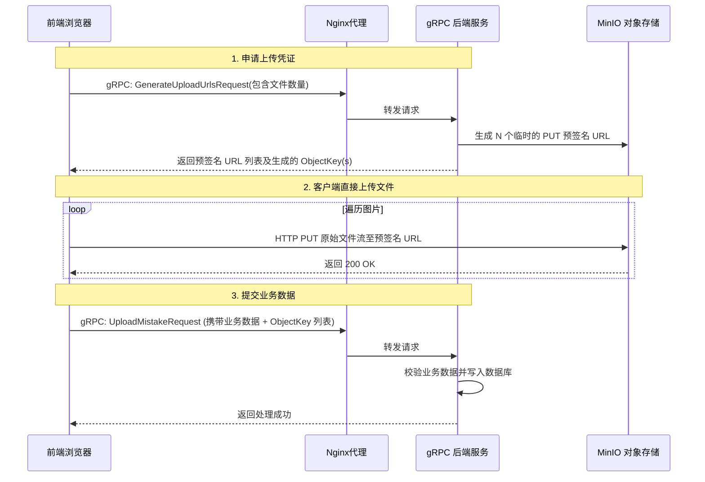

# Ruoyu.Study.Grpc.Mistake 审计报告 (复审更新版)

## 1. 严重问题 (Critical Issues)

### 1.1 浏览器经 Nginx 转发场景下的文件上传与性能隐患
* **发现**：`mistake.proto` 中的 `UploadMistakeRequest` 和 `AddMistakePracticeRequest` 仍在使用 `repeated bytes images` 传输原图，且 `MistakeServiceImpl` 中依然在处理该字节流。
* **影响**：既然架构设计是由前端页面通过 Nginx 转发请求到后端，前端通常只能发起 HTTP/1.1 或普通 HTTP/2 请求（通过 gRPC-Web 或 gRPC-JSON Transcoding 转换）。在这种情况下，`bytes` 数组会被 Base64 编码，导致载荷体积膨胀 33% 以上。这不仅极易突破 gRPC 默认的 4MB 消息限制，还会给前端、Nginx 和后端的内存带来沉重的序列化/反序列化负担。此外，浏览器端本身也不支持 gRPC 的客户端流式传输（Client Streaming）。

---

## 2. 详细重构解决方案：MinIO 预签名 URL 直传 (推荐)

经过仔细评估，针对“前端 -> Nginx -> gRPC”架构，最彻底、最高效的解决方案是**剥离二进制文件传输**，采用 **MinIO 预签名 URL 直传 (Presigned URL)** 方案。

这种方案的好处是：
1. **完全解放 gRPC 和 Nginx**：gRPC 只负责轻量级的 JSON/业务文本数据，Nginx 不需要代理大文件（避免 413 Payload Too Large 问题），后端服务器内存也不会因为 Base64 解码而爆满。
2. **极速传输**：前端直接利用浏览器的并发能力，将原始图片文件（不经过 Base64 膨胀）通过 `PUT` 请求直接上传到 MinIO。

### 2.1 重构后的交互流程



### 2.2 详细代码修改指南

#### 步骤 1：修改 `mistake.proto` 文件
将原来的 `bytes` 字段彻底移除，新增申请 URL 的接口，并将提交接口改为接收图片的 URL/Key。

```protobuf
// 1. 新增获取预签名 URL 的请求和响应
message GenerateUploadUrlsRequest {
  string student_id = 1;
  int32 count = 2; // 需要上传的图片数量
  string prefix = 3; // 前缀，如 "mistake" 或 "practice"
}

message GenerateUploadUrlsResponse {
  repeated UploadUrlInfo urls = 1;
}

message UploadUrlInfo {
  string object_key = 1; // 最终保存在数据库里的路径/Key (如 m_uuid_0.jpg)
  string put_url = 2;    // 前端用来发起 PUT 请求的完整 URL
}

// 2. 修改业务提交接口，移除 bytes，改为 string
message UploadMistakeRequest {
  // ... 保留其他字段 ...
  // repeated bytes images = 4; (删除这行)
  repeated string image_keys = 4; // 替换为前端传来的 object_key 列表
}

message AddMistakePracticeRequest {
  // ... 保留其他字段 ...
  // repeated bytes images = 3; (删除这行)
  repeated string image_keys = 3; // 替换为前端传来的 object_key 列表
}

// 3. 在 service 中注册新接口
service MistakeGrpcService {
  rpc GenerateUploadUrls(GenerateUploadUrlsRequest) returns (GenerateUploadUrlsResponse);
  // ... 其他不变 ...
}
```

#### 步骤 2：在 `IOssService` 中实现预签名逻辑
修改 MinIO 封装类，调用 MinIO SDK 的 `PresignedPutObjectAsync` 方法。

```csharp
// 在 MinioOssService.cs 中增加：
public async Task<string> GeneratePresignedPutUrlAsync(string bucketName, string objectName, int expiryMinutes = 15)
{
    var args = new PresignedPutObjectArgs()
        .WithBucket(bucketName)
        .WithObject(objectName)
        .WithExpiry(expiryMinutes * 60);

    return await _minioClient.PresignedPutObjectAsync(args);
}
```

#### 步骤 3：在 `MistakeServiceImpl.cs` 中实现接口
实现新的申请 URL 接口，并修改原有的上传接口（因为此时图片已经在 MinIO 中了，后端不需要再处理 `List<byte[]>`）。

```csharp
// 1. 实现生成预签名 URL 的接口
public override async Task<GenerateUploadUrlsResponse> GenerateUploadUrls(GenerateUploadUrlsRequest request, ServerCallContext context)
{
    var response = new GenerateUploadUrlsResponse();
    var batchId = Guid.NewGuid().ToString("N");
    
    for (int i = 0; i < request.Count; i++)
    {
        var objectKey = $"{request.Prefix}_{batchId}_{i}.jpg";
        var putUrl = await _ossService.GeneratePresignedPutUrlAsync(OssBucket.Mistakes, objectKey);
        
        response.Urls.Add(new UploadUrlInfo
        {
            ObjectKey = objectKey,
            PutUrl = putUrl
        });
    }
    return response;
}

// 2. 简化原有的 UploadMistake 方法
public override async Task<MistakeDto> UploadMistake(UploadMistakeRequest request, ServerCallContext context)
{
    var entity = request.Adapt<MistakeEntity>();
    
    // 直接将前端传来的 Keys 赋值给实体
    if (request.ImageKeys != null && request.ImageKeys.Count > 0)
    {
        entity.ImagePaths = request.ImageKeys.ToList();
    }

    // 调用 DomainService 写入数据库即可，不需要再传 images 字节流了
    var result = await _mistakeService.UploadMistakeAsync(entity);
    return result.Adapt<MistakeDto>();
}
```

#### 步骤 4：在 `MistakeDomainService.cs` 中清理冗余逻辑
既然上传工作交给了前端直传，DomainService 中原有的 `await _ossService.UploadAsync(...)` 逻辑可以被完全删除，只保留数据库的 CRUD 和 ProcessLog 记录逻辑即可。

### 2.3 前端对接注意事项
前端在拿到 `GenerateUploadUrlsResponse` 后，需要使用原生的 `fetch` 或 `axios` 发起 HTTP `PUT` 请求：

```javascript
// 前端伪代码示例
async function uploadImages(files) {
    // 1. 通过 gRPC-Web 申请 URL
    const res = await grpcClient.generateUploadUrls({ count: files.length, prefix: 'mistake' });
    const imageKeys = [];

    // 2. 并发上传图片到 MinIO
    const uploadPromises = files.map((file, index) => {
        const urlInfo = res.urls[index];
        imageKeys.push(urlInfo.objectKey);
        return fetch(urlInfo.putUrl, {
            method: 'PUT',
            body: file,
            headers: { 'Content-Type': file.type }
        });
    });
    await Promise.all(uploadPromises);

    // 3. 提交业务单据
    await grpcClient.uploadMistake({
        studentId: '123',
        imageKeys: imageKeys, // 将刚上传的 Key 传给后端
        // ...
### 2.4 实施时机建议 (关于鉴权)

**强烈建议：等待登录鉴权（Identity/Auth）服务就绪后再全面实施此方案。**

原因如下：
1. **安全性风险**：如果当前系统没有健全的认证授权机制，任何人都可以调用 `GenerateUploadUrls` 接口无限申请 MinIO 的预签名 URL，进而向你的 MinIO 桶中恶意灌入大量垃圾文件，造成严重的存储成本和安全漏洞。
2. **凭证隔离**：在完善的系统中，申请预签名 URL 时，后端需要从 JWT Token 等上下文中提取出真实的用户 ID（而不是依靠前端传递的 `student_id` 参数），以此来隔离每个人只能上传到属于自己的目录，并防止伪造身份。
3. **平滑过渡**：目前的 `repeated bytes images` 虽然存在性能隐患，但在本地开发、测试阶段（数据量不大）是完全能够 Work 的。

**当前阶段的结论**：
将这个“预签名直传”方案作为架构演进的 **Next Step（下一步计划）** 记录在此。在咱们项目的 Auth 服务搭建完毕、gRPC 拦截器能够成功解析 Token 后，再回过头来将图片上传彻底重构为本方案。


